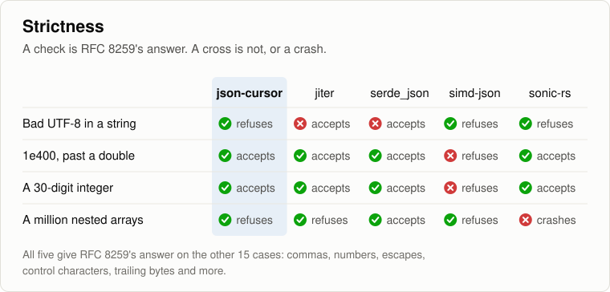

# json-cursor

[](https://crates.io/crates/json-cursor)
[](https://docs.rs/json-cursor)
[](https://github.com/FusionVault/json-cursor/actions/workflows/ci.yml)
[](https://github.com/FusionVault/json-cursor/blob/main/Cargo.toml)

**Read JSON one value at a time: fast, strict, and with every number exact.**

json-cursor walks through a JSON document from start to end. You ask for the next key, string
or number, and it hands it to you straight from your bytes, so you can build your own types with
no tree in between.

- **Fast.** It reads JSON faster than serde_json, sonic-rs, simd-json and jiter in our
  [benchmarks](#speed).
- **Strict.** It checks every byte against the JSON standard,
  [RFC 8259](https://www.rfc-editor.org/rfc/rfc8259), even in values you skip.
- **Exact.** A number keeps its text as written, and its value comes out exactly.
- **Light.** No dependencies, no `unsafe` code, and it works in `no_std` with `alloc`.

## Quick start

```bash
cargo add json-cursor
```

```rust
use json_cursor::Cursor;

#[derive(Default)]
struct Person {
    name: String,
    born: i64,
}

let json = br#"{"name": "Ada", "born": 1815, "languages": ["English", "French"]}"#;
let mut person = Person::default();

let mut cursor = Cursor::from_bytes(json)?;
let mut buf = String::new(); // used only when a key or string has escapes

let mut next = cursor.first_key(&mut buf)?;
while let Some(key) = next {
    match key {
        "name" => person.name = cursor.string(&mut buf)?.to_string(),
        "born" => person.born = cursor.number()?.as_i64().unwrap_or_default(),
        _ => cursor.skip()?, // anything else is checked, then passed over
    }
    next = cursor.next_key(&mut buf)?;
}
cursor.finish()?; // only whitespace may follow

assert_eq!(person.name, "Ada");
assert_eq!(person.born, 1815);
# Ok::<(), json_cursor::Error>(())
```

## Reading values

Make a cursor with `Cursor::new` for a `&str`, or with `Cursor::from_bytes` for bytes. Then read
whatever comes next with the method for its kind:

| To read | Call | You get |
|---|---|---|
| an object | `first_key`, then `next_key` after each value | each key, then `None` at the end |
| an array | `first_item`, then `next_item` after each item | `true` while there is another item |
| a string | `string` | a `&str` |
| a number | `number` | a `Number` |
| `true` or `false` | `bool` | a `bool` |
| `null` | `null` | nothing |
| anything you do not need | `skip` | nothing, but every byte is checked |
| whatever comes next | `value` | a `Value`, which says what it found |

When you are done, `finish` checks that nothing but whitespace follows.

Here is an array:

```rust
use json_cursor::Cursor;

let mut cursor = Cursor::new("[1.5, 2.5, 3]");
let mut total = 0.0;

let mut more = cursor.first_item()?;
while more {
    total += cursor.number()?.as_f64();
    more = cursor.next_item()?;
}
assert_eq!(total, 7.0);
# Ok::<(), json_cursor::Error>(())
```

When you do not know what comes next, `value` reads it and tells you what it was:

```rust
use json_cursor::{Cursor, Value};

let mut cursor = Cursor::new(r#"["text", 42, true, null, [1, 2]]"#);
let mut buf = String::new();

let mut more = cursor.first_item()?;
while more {
    match cursor.value(&mut buf)? {
        Value::String(text) => println!("a string: {text}"),
        Value::Number(number) => println!("a number: {}", number.text()),
        Value::Bool(flag) => println!("a boolean: {flag}"),
        Value::Null => println!("null"),
        Value::Array | Value::Object => cursor.skip()?, // not read yet, so skip it
    }
    more = cursor.next_item()?;
}
# Ok::<(), json_cursor::Error>(())
```

## Numbers

A `Number` gives you its text exactly as written, and its value in the form you need:

```rust
use json_cursor::Cursor;

let mut cursor = Cursor::new("[12.50, 7.0, 123456789012345678901234567890]");
cursor.first_item()?;

let price = cursor.number()?;
assert_eq!(price.text(), "12.50"); // exactly as written
assert_eq!(price.as_f64(), 12.5); // the nearest f64
cursor.next_item()?;

let count = cursor.number()?;
assert_eq!(count.as_i64(), Some(7)); // a whole number, though written with a point
cursor.next_item()?;

let big = cursor.number()?;
assert_eq!(big.as_i64(), None); // too big for an i64,
assert_eq!(big.text(), "123456789012345678901234567890"); // but no digit is lost
# Ok::<(), json_cursor::Error>(())
```

- `text()` is the number exactly as written, so a decimal can keep every digit.
- `as_i64()` is the whole number, however it is written: `7`, `7.0` and `1e3` all work. A
  fraction such as `1.5`, or a number too big for an `i64`, gives `None`. It never rounds.
- `as_f64()` is the nearest `f64`, always: the same answer as Rust's own parser.
- `is_integer()` says whether the number is written with digits only.

## Checking a document

`validate` checks a whole document without reading anything out of it:

```rust
assert!(json_cursor::validate(br#"{"id": 7, "tags": ["a", "b"]}"#).is_ok());
assert!(json_cursor::validate(br#"{"id": 7,}"#).is_err()); // a trailing comma
```

## Errors

Every method returns a `Result`. An `Error` says what went wrong, and at which byte:

```rust
let error = json_cursor::validate(b"[1, 2,]").unwrap_err();
assert_eq!(error.to_string(), "expected a value at byte 6");
```

json-cursor refuses anything that is not JSON:

- a missing or extra comma or colon, such as `[1,]` or `{"a" 1}`;
- a key that is not a string;
- a number such as `01`, `1.`, `.5`, `+1` or `NaN`;
- a raw control character inside a string, or an escape that JSON does not have;
- half of a surrogate pair, such as `"\ud800"` on its own;
- bytes that are not UTF-8;
- anything after the value, other than whitespace;
- nesting deeper than 128 arrays and objects, inside a value you skip. You can change the limit
  with `with_depth_limit`.

A repeated key is not an error. RFC 8259 allows it. The cursor gives you each key in turn, and
you decide which one wins.

## Speed

We raced json-cursor against four popular Rust JSON parsers, on three kinds of message:

- **Bids**, 248 bytes: numbers and short text, like an auction feed.
- **Events**, 723 bytes: long strings, with escapes, accents and emoji.
- **GeoJSON**, 3,246 bytes: a polygon of 120 points, numbers almost all the way.

<picture>
  <source media="(prefers-color-scheme: dark)" srcset="benchmarks/charts/read-dark.svg">
  
</picture>

<picture>
  <source media="(prefers-color-scheme: dark)" srcset="benchmarks/charts/validate-dark.svg">
  
</picture>

json-cursor is the fastest at reading every value, on all three kinds of message. It is also the
fastest at validating bids and GeoJSON. On events it validates as fast as jiter, even though jiter
skips the UTF-8 check inside strings and json-cursor does not.

<details>
<summary>The numbers, and how we measured them</summary>

Median CPU time per message, in nanoseconds. serde_json Value builds a tree of the whole message,
so it is shown for scale.

| Message | Job | json-cursor | jiter | serde_json | simd-json | sonic-rs | serde_json Value |
|---|---|---|---|---|---|---|---|
| Bids | read every value | **178** | 325 | 287 | 285 | 199 | 715 |
| Bids | validate | **111** | 177 | 153 | 275 | 173 | |
| Events | read every value | **282** | 372 | 615 | 442 | 405 | 1,101 |
| Events | validate | **203** | **201** | 263 | 430 | 224 | |
| GeoJSON | read every value | **4,160** | 6,198 | 5,641 | 5,866 | 4,384 | 15,462 |
| GeoJSON | validate | **2,119** | 3,044 | 2,725 | 5,401 | 2,831 | |

- **Reading every value** visits each key and value, as a decoder does. json-cursor and jiter use
  their own APIs. serde_json, simd-json and sonic-rs fill the same serde visitor. Before timing,
  every parser must read the same values from every message.
- **Validating** checks a message and keeps nothing.
- **How:** each parser's CPU time on one idle core, the median of 15 rounds, with the parsers
  taking turns in each round.
- **On:** an AMD Ryzen 9 5950X with Ubuntu 24.04 and Rust 1.98, built for plain x86-64 (no
  `target-cpu=native`), in release mode with thin LTO.
- **Versions:** jiter 0.19.0, serde_json 1.0.154, simd-json 0.19.0 and sonic-rs 0.5.10.
- A parser's time can move by 10% or more from one build to the next, with no change to its
  code, as the compiler lays the code out differently. In every build of this version we ran,
  json-cursor stayed in front in each race it leads here.

To run them yourself:

```bash
cd benchmarks
cargo build --release
taskset -c 15 target/release/json-cursor-benchmarks speed > results/speed.csv
target/release/json-cursor-benchmarks strict > results/strict.csv
target/release/json-cursor-benchmarks exact > results/exact.csv
target/release/json-cursor-benchmarks rounding > results/rounding.csv
python3 charts.py
```

`taskset -c 15` keeps the run on one core. Pick one that is idle on your machine.

</details>

### Why it is fast

- **It reads eight bytes at a time.** Bit tricks on a 64-bit word find the end of a string, and
  count and read a number's digits.
- **It reads each number once.** The digits are added up while the number is checked, so most
  numbers become an `f64` with one multiplication or division.
- **It looks at each value once.** The first byte of a value decides how it is read.
- **It keeps its place in a register.** Skipping a value keeps track of the open arrays and objects
  in one 64-bit word, a bit for each.
- **It checks UTF-8 once.** `from_bytes` checks all the bytes in one fast pass. `validate` checks
  only strings that hold bytes that are not ASCII.
- **It keeps rare work out of the way.** Escapes, very long numbers and errors are handled in
  separate functions, so the common path stays small.

## Accuracy

<picture>
  <source media="(prefers-color-scheme: dark)" srcset="benchmarks/charts/strict-dark.svg">
  
</picture>

We gave each parser 26 tricky messages. RFC 8259 decides 22 of them, and json-cursor answered all
22 as the RFC says. The RFC leaves the other 4 to each parser, such as a million nested arrays, and
json-cursor refuses them safely.

- **jiter and serde_json accept bad UTF-8** in the strings they validate.
- **simd-json refuses some valid numbers,** such as `1e400` and a 30-digit integer.
- **sonic-rs crashes** on a million nested arrays. Its stack overflows, which no program can catch.
  json-cursor stops at its depth limit with an error.

**Numbers stay exact.** Here is what each parser gives for three numbers that a double cannot
hold:

| | A 48-digit integer | `1e400` | `0.1000000000000000055511151231257827` |
|---|---|---|---|
| json-cursor | the exact text | the exact text | the exact text |
| jiter | the exact integer | infinity | 0.1 |
| serde_json | a rounded double | an error | 0.1 |
| simd-json | an error | an error | 0.1 |
| sonic-rs | a rounded double | an error | 0.1 |

**Doubles are always the nearest.** We read a million random long decimals, such as
`85233071271705465e11`, with each parser. json-cursor, jiter, simd-json and sonic-rs gave the
nearest double every time. serde_json missed it on 319,907 of them, by default.

## How it is tested

- **Every rule of RFC 8259,** case by case, with the error each mistake gives.
- **[JSONTestSuite](https://github.com/nst/JSONTestSuite):** all 318 cases. json-cursor accepts
  every valid one and refuses every invalid one.
- **Against serde_json,** on two million random documents, some of them damaged. Both must accept
  the same documents and read the same values.
- **Numbers,** against Rust's own parser, bit for bit, on every edge case and 300,000 random
  numbers.
- **Mutation testing:** we broke each of 32 rules in the code, one at a time, and a test failed
  every time.
- **CI** checks the oldest supported Rust, 1.85, and a `no_std` build.

## License

Apache-2.0. See [LICENSE](https://github.com/FusionVault/json-cursor/blob/main/LICENSE) and
[NOTICE](https://github.com/FusionVault/json-cursor/blob/main/NOTICE).
